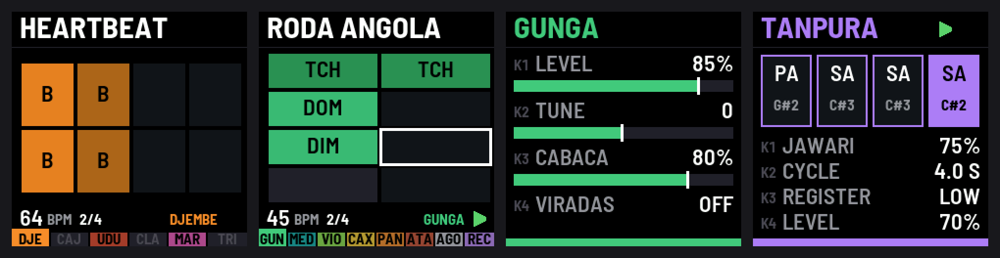

# FM-1_DelRio: a ceremony rhythm box for the M-VAVE FM-1

A firmware that turns the M-VAVE FM-1 into a small rhythm box of hand percussion, made to accompany songs in a
circle: **djembe, cajon, udu, clapsticks, maracas and triangle**. Choose a rhythm, set the tempo, press PLAY and sing;
or play the instruments on the keys, record them into the loop, and shape them step by step. **The berimbau** has its
own page, with its toques and the capoeira's bateria (the medio and the viola, pandeiro, atabaque, agogô, reco-reco);
two drones, **the tanpura** and **the shruti box**, sound alone or under the rhythm.

By Jess Del Rio. Its splash screen says DEL RIO; its USB name is "FM-1 DelRio", its identity FM-1_48 and the version
(FM-1_48010000 is 1.0).

*The FM-1's 240 × 240 screen: an instrument's steps in its colour, a row a beat, the step playing framed in white; the
tempo and the rhythm at the bottom, over a band of the page's instruments; a page of large sliders. [All the
screens](docs/img/all-screens.png).*

## What it does

- **Six instruments, with their real strokes.** Djembe (bass, tone, slap), cajon (bass, slap), udu (bass, tone, slap),
  clapsticks, maracas, triangle (open, muted).
- **The black keys play them**, grouped as the keys are:
  - djembe bass, tone, slap;
  - cajon bass, slap;
  - udu bass, tone, slap;
  - clapsticks, maracas;
  - triangle.
  Harder is louder.
- **The white keys are a step sequencer** for the instrument shown. Each press puts that step's next stroke, and after
  the last, none. A bar has 2 to 8 beats of 2, 3 or 4 steps; when it is longer than the 16 keys, they follow the step
  sounding.
- **PLAY loops the rhythm; REC records what you play on the black keys**, each stroke onto the nearest step, over
  what is there. From a stop, a bar is counted in first. The sequencer runs in the audio interrupt, to the sample.
- **Everything changes on the bar.** A rhythm chosen while one plays comes in on the next bar's first beat (its name
  yellow in the footer till then). PLAY while playing stops on the next bar's first beat, its strokes the last (PLAY
  blinks, a white square in the footer); PLAY again stops at once. A tempo set while playing glides there over a bar;
  a tapped one (SEQ) is there at once.
- **Each rhythm keeps its tempo**: set it once, and it comes back at it, away and back (SAVE keeps it).
- **39 rhythms, grouped by their beats.** ALGORITHM chooses the beats; PRESETS goes round the rhythms with those beats,
  each coming as it is written. Each number of beats has a FREE rhythm of your own.
- **The berimbau and the capoeira's bateria (FX)**, played as the kit is:
  - three berimbaus, as in a roda: the GUNGA (the lowest), the MEDIO and the VIOLA, a tone up each (each one's DIM the
    next one's DOM, as a bateria is commonly tuned); SELECT
    shows each, then the caxixi, the PANDEIRO, the ATABAQUE, the AGOGÔ and the RECO-RECO, each with its steps;
  - its black keys: the berimbau shown, DOM (the wire struck free), DIM (the stone pressed on it, a tone higher), TSCH
    (the stone resting on it, a buzz); the caxixi and the reco-reco; the pandeiro's TUM (thumb), PA (slap) and CHIA
    (its jingles); the atabaque's TUM and PA (with ARP held, the agogô's high and low bells); the last, VIRADA;
  - **the cabaça**: a berimbau's keys pressed harder close its gourd on the belly, its sound muffled as far as the
    pressure goes, the "wah" of a roda (SOUND, CABACA: how far, 0 to 100 %);
  - **viradas**: each berimbau varies its toque now and then (SOUND, VIRADAS: every 8, 4 or 2 bars, every bar, or
    never; the viola every 4 at first), and VIRADA has the berimbau shown vary from the next bar. ANGOLA and SAO
    BENTO GRANDE de Angola play the sources' own variations, two bars each (below); the other toques a bar made from
    the toque, not transcribed: its DOM and DIM struck twice in the bar's second half (dobrado), its last beat all DIM
    (repique), or its rests filled with soft chiados;
  - its toques: ANGOLA, SB PEQUENO, SB GRANDE, BANGUELA, JOGO DE DENTRO, JOGO DE FORA, SB REGIONAL, CAVALARIA,
    IDALINA and MIUDINHO, and two FREE ones, a quarter slower than a roda plays them (ANGOLA at 90: its quarter
    note at 45);
  - the berimbau's strokes recorded from Paulo Gonçalves's; the bateria's synthesised (`app/tools/synth.py`).
- **Only what a player can change.** Each instrument's SOUND page has only what is real for it:
  - djembe: level, tuning (its ropes), decay (a hand on the head);
  - cajon: level, snare wires (down to off), decay (a heel on the front);
  - udu: level, size (tuning), how far a pressed key lowers the bass (a palm closing the opening);
  - maracas: level, a short or long shake;
  - triangle: level, ring;
  - gunga, medio, viola: level, tuning (its wire), cabaça, viradas;
  - atabaque: level, tuning;
  - clapsticks, caxixi, agogô, pandeiro, reco-reco: level.
- **Played like the instruments.**
  - The triangle rings while its key is held, and the hand closes on it when let go. A short tap is a muted stroke.
  - Pressing the udu's bass key harder lowers its pitch.
  - With ARP held, the djembe's strokes are flams, and the clapsticks' and the maracas' keys the agogô's two bells
    (high, low: ijexá's and afoxé's bell).
  - The maracas are one pair of hands, so a stroke stops the one before.
- **One control per setting:**
  - SELECT: the instrument.
  - SEL: mute.
  - EDIT twice: clear.
  - SEQ: tap tempo.
  - SAVE: keep everything.
  - FX: the kit, the tanpura, the shruti box, the berimbau.
  - OCT− / OCT+: the tempo, 5 BPM a press, 10 held.
  - LFO: the presets listed, with their beats (the number at the right), from the one chosen; the list stays, KNOB 3 goes through it without
    changing anything; LFO held chooses the one shown, LFO again closes the list.
- **Two drones (FX), alone or under the rhythm.** The kit playing, FX shows the tanpura (the kit plays on); its PLAY
  starts it, HOME (on its page) goes back to the kit, the drone sounding on. One drone at a time; the berimbau's page
  stops the kit, not the drone.
  - TANPURA: four strings plucked in turn (Pa – Sa – Sa – low Sa), buzzing on their bridge (the jawari). A key sets Sa;
    ALGORITHM tunes the first string (SA PA, SA MA for the ragas without Pa, SA NI); PRESETS sets its character: MEDITATION (slow, a soft jawari), MANTRA (round), RAGA
    (the concert tanpura's open jawari), KIRTAN (quicker, brighter). KNOB 1 the jawari, KNOB 2 the cycle, KNOB 3 the
    register, KNOB 4 the level.
  - SHRUTI: the shruti box's reeds, held while the bellows breathe. PRESETS: the chord a key plays, SA PA (root, fifth,
    octave), MAJOR or MINOR; or NOTES, each key opening or closing its reed. The bellows go back and forth in time:
    KNOB 1 how strongly they breathe (steady at 0; at the most the sound falls away where the hand turns), KNOB 2 their
    tempo (a push, then a pull, each a beat; under 20, RHYTHM: the rhythm's tempo, halved above 120), KNOB 3 the
    level. A bar under the reeds shows the bellows breathing.
  - Both are synthesised as they play: no samples.
- **A minimal screen, large type, a colour per instrument.** Under the steps, a band of the page's instruments: the
  one shown tall, the others in their colour when they play in the rhythm (white as they strike, grey muted), and a
  drone sounding under it. The berimbaus' steps read DOM, DIM, TCH. At start, a maned wolf (the lobo-guará of the cerrado)
  walks into the cerrado at dusk, in big pixels (80 x 80, 32 colours), his four legs stepping in turn, and stops
  before the setting sun; a key, a button or a knob skips it. The pictures are Jess Del Rio's (`app/art/`);
  `app/tools/opening.py` makes the scene and cuts the wolf out.
- **The battery, top right:** three bars, the outline red when it is empty; USB while a computer powers the FM-1. The
  keys' velocity holds the converter that reads it, so every 10 s, with no key down, it is let go for 2 ms.
- **A screen reader can follow it** (fm1-reader, over USB).

### The rhythms

| Beats | Rhythms |
| --- | --- |
| 2 | HEARTBEAT, BAIAO, XOTE, SAMBA, MARCHA 2/4, MAZURCA, BARRAVENTO, JOROPO, FREE |
| 3 | THREE, VALSA, TOADA, FREE |
| 4 | FOUR, JOURNEY, SHAKER, CLAVE, AFRO 12/8, MARCHA, IJEXA, IJEXA CANTO, KUKU, AFRO SAMBA, BOSSA NOVA, FUNK IJEXA, SAMBA DJEMBE, XOTE DJEMBE, DJOLE, YANKADI, FREE |
| 5 | FIVE, FREE |
| 6 | LANDO, BULERIAS, FREE |
| 7 | SEVEN, FREE |
| 8 | AFOXE, FREE |

The berimbau's toques:

| Beats | Toques |
| --- | --- |
| 4 | ANGOLA, SB PEQUENO, SB GRANDE, BANGUELA, JOGO DE DENTRO, JOGO DE FORA, RODA ANGOLA, FREE |
| 8 | SB REGIONAL, CAVALARIA, IDALINA, MIUDINHO, FREE |

Where they come from:

- **Santo Daime, the maracá:** MARCHA (f f f F), VALSA (F F f), MAZURCA (6/8, f f f F F F), as described by the Jornal
  Grande Bahia, "Abaixo o maracá. Viva o maracá" (2016).
- **Umbanda, the atabaque on the djembe** (Tum its bass, Ta its tone): IJEXA ("Ta TaTa Tum Ta") and BARRAVENTO
  ("Tum TaTa TumTum", 6/8), from the Templo Tata Possum's *Curso de Atabaque* (2024).
- **Brazil:**
  - BAIAO: the zabumba, and the triangle closed with the off-beats open (ANPPOM 2018).
  - SAMBA: the surdo and the ganzá.
- **Each instrument's own:**
  - KUKU: the Mandinka djembe's accompaniment, "B.TT..S.B.TT..S." (M. Gąsewicz, "A rhythm notation for djembe and
    dundun drums", BachoTeX 2023).
  - LANDO: the Afro-Peruvian cajon, "B . F . B B | . F B . F B" in 6/4, F a flam (Wikipedia, "Landó (music)"; Thomann's
    cajon guide).
  - BULERIAS: the flamenco cajon's slaps on the compás's accents, 3, 6, 8, 10 and 12 of 12 (K. Kocoshis, *Percussive
    Notes*, 2025).
  - JOROPO: the llanero maracas, six eighths accented as 6/8 (Radio Nacional de Colombia).
- **Brazil's on the djembe:** AFOXE (two bars), AFRO SAMBA, BOSSA NOVA, FUNK IJEXA, SAMBA DJEMBE and XOTE DJEMBE, as
  the [djembegorilla.com library](https://djembegorilla.com/library/rhythms/?filter_origin=brazil) writes them, in
  sixteenths (its muted tones and taps are soft tones here).
- **West Africa's:** DJOLE (the Temine's mask dance: its third djembe part, the kenkeni's bell on the clapsticks, the
  dundunba on the cajon) and YANKADI (the Sousou's slow dance: its first djembe part, the dundunba's bell on every
  pulse), from Paul Nas's box notations, *West African Percussions*.
- **The urban neo-ayahuasca circles:** IJEXA CANTO, XOTE, MARCHA 2/4, TOADA, and BAIAO's djembe are the grooves they
  play on the djembe under their cantos. They are practical adaptations, not canonical transcriptions: the Huni Kuin's
  own cantos are carried by the voice, with a maracá at most.
- **The berimbau's toques**, as the Cordão de Ouro teaches them (*Toques do berimbau*, Flensburg 2020): counted
  "0 – 1 – 2 – 3", the two chiados (TSCH) on 0, then the DOM and the DIM on the beats. SB REGIONAL is Mestre Bimba's,
  over two counts: "tsch tsch DOM, tsch DIM, tsch tsch DOM DOM DIM". JOGO DE FORA (Jogo de Dentro turned over),
  CAVALARIA (whole: "tsch tsch DOM, tsch DOM, tsch tsch DOM DIM DOM"), IDALINA and MIUDINHO follow
  [opencapoeira.com's notations](https://opencapoeira.com/toques-de-berimbau/), its | a chiado, || two.
- **The roda of capoeira Angola (RODA ANGOLA)**: the gunga plays ANGOLA, the medio SÃO BENTO PEQUENO and the viola
  SÃO BENTO GRANDE de Angola, as the Companhia Pernas Pro Ar's "Toques de Berimbau" (2023) and Capoeira Baobá (2026)
  give them. The pandeiro and the atabaque as Elias's *Só Ritmo* (Grupo Capoeira Brasil, 2017) writes their capoeira
  grooves; the agogô and the reco-reco as Wikipedia's "Capoeira music" has them (uncited there). Sources disagree on
  the atabaque (Wikipedia's open tones are *Só Ritmo*'s basses).
- **The viradas**: ANGOLA's, the viola's "common variations" in Wikipedia's "Capoeira toques"; SÃO BENTO GRANDE de
  Angola's, *Só Ritmo*'s "Viradas".
- **IJEXA's agogô**, high and low in sixteenths: Gilson de Assis, *Brazilian Conga* (Advance Music, 2006), "Ijexá",
  Agogo 1; the same in Pascoal Meirelles's teaching book (UFRJ, 2024).
- **Choosing for a canto such as Jiboia**, by ear:
  - IJEXA CANTO when it drags and sways;
  - BAIAO or MARCHA 2/4 when it pushes you to dance;
  - TOADA when it is ternary.

## Install

From [The Firmware Hub](https://thefirmwarehub.com/), or with the `.fwsc` of the
[latest release](https://github.com/jsopdebeeck/fm1-delrio/releases/latest).

It keeps only its own settings and rhythms (SAVE), in its own place in the FM-1's flash. It does not read other
firmwares' projects or samples.

## The sounds

`app/kit/` holds one WAV per stroke. `app/tools/kit.py build` turns them into `app/dsp/kit_samples.c` (about 346 KB of
the FM-1's flash: 8 bits a sample, in blocks of 16 that each keep their own scale, the noise about 44 dB under each
block's loudest). The tanpura and the shruti box use no samples: they are synthesised as they play.

| Instrument | Source | Licence |
| --- | --- | --- |
| Cajon, clapsticks (claves), maracas (a large shaker's hits), triangle | [VCSL](https://github.com/sgossner/VCSL), the Versilian Community Sample Library, by Versilian Studios | CC0 1.0 |
| Udu, bass | ["122-Udu" by klemmy](https://freesound.org/s/203349/) | CC BY 3.0 |
| Udu, tone and slap | ["Pong Pop" by AncientOracle](https://freesound.org/s/476883/), cut | CC BY 4.0 |
| Berimbau (DOM; DIM, a tone higher and damped; TSCH, damped) | ["Berimbau_03"](https://freesound.org/s/177068/), ["Berimbau_01"](https://freesound.org/s/177004/) and ["Berimbau_02"](https://freesound.org/s/177003/) by Paulo Gonçalves, cut | CC BY 4.0 |
| Caxixi | ["Musical, percussion, caxixi, shake…"](https://freesound.org/s/856789/) by Oldome, cut | CC0 1.0 |
| Djembe; agogô, pandeiro, atabaque, reco-reco | synthesised by `app/tools/synth.py` | |
| Medio, viola | the berimbau's strokes, played 3 and 7 semitones higher | CC BY 4.0 |

Any stroke can be replaced by your own recording: drop a WAV named after it (`djembe_bass.wav`, `triangle_muted.wav`…)
into `app/kit/` and run `app/tools/kit.py build`.

## Licence

The code is under the Mozilla Public License 2.0 ([LICENSE](LICENSE)), as fm1-base is. The sounds keep their own
licences (above, and `app/kit/CREDITS.txt`).

It is built on fm1-base by Charles Vestal and on felucca-bsp, from Felucca by Leo Kuroshita (Hügelton Instruments).
M-VAVE and FM-1 are trademarks of their owners; this firmware is not affiliated with M-VAVE.
