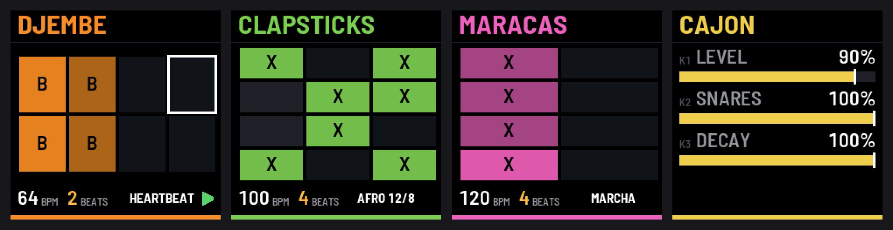

# FM-1_DelRio: a ceremony rhythm box for the M-VAVE FM-1

A firmware that turns the M-VAVE FM-1 into a small rhythm box of hand percussion, made to accompany songs in a
circle: **djembe, cajon, udu, clapsticks, maracas and triangle**. Choose a rhythm, set the tempo, press PLAY and sing;
or play the instruments on the keys, record them into the loop, and shape them step by step. Three more instruments
are each played alone: **the berimbau** with its toques, and two drones, **the tanpura** and **the shruti box**.

By Jess Del Rio. Its splash screen says DEL RIO; its USB name is "FM-1 DelRio", its identity FM-1_48 and the version
(FM-1_48000200 is 0.2).



*The FM-1's 240 × 240 screen: an instrument's steps in its colour, a row a beat, the step playing framed in white;
the tempo, the beats and the rhythm at the bottom; a page of large sliders. [All the screens](docs/img/all-screens.png).*

## What it does

- **Six instruments, with their real strokes.** Djembe (bass, tone, slap), cajon (bass, slap), udu (bass, tone, slap),
  clapsticks, maracas, triangle (open, muted).
- **The black keys play them**, grouped as the keys are:
  - djembe bass, tone, slap;
  - cajon bass, slap;
  - udu bass, tone, slap;
  - clapsticks, maracas;
  - triangle.
  Harder is louder.
- **The white keys are a step sequencer** for the instrument shown. Each press puts that step's next stroke, and after
  the last, none. A bar has 2 to 8 beats of 2, 3 or 4 steps; when it is longer than the 16 keys, they follow the step
  sounding.
- **PLAY loops the rhythm; REC records what you play on the black keys**, each stroke onto the nearest step, over
  what is there. From a stop, a bar is counted in first. The sequencer runs in the audio interrupt, to the sample.
- **31 rhythms, grouped by their beats.** ALGORITHM chooses the beats; PRESETS goes round the rhythms with those beats,
  each coming as it is written. Each number of beats has a FREE rhythm of your own.
- **The berimbau, played alone (FX)**, as the kit is played:
  - its black keys: DOM (the wire struck free), DIM (the stone pressed on it, a tone higher), TSCH (the stone resting
    on it, a buzz), then the caxixi; the same again, for the other hand;
  - its toques: ANGOLA, SB PEQUENO, SB GRANDE, BANGUELA, CAVALARIA, JOGO DE DENTRO and SB REGIONAL, and a FREE one;
  - SELECT: the berimbau or its caxixi, each with its steps;
  - the strokes recorded from Paulo Gonçalves's berimbau.
- **Only what a player can change.** Each instrument's SOUND page has only what is real for it:
  - djembe: level, tuning (its ropes), decay (a hand on the head);
  - cajon: level, snare wires (down to off), decay (a heel on the front);
  - udu: level, size (tuning), how far a pressed key lowers the bass (a palm closing the opening);
  - maracas: level, a short or long shake;
  - triangle: level, ring;
  - berimbau: level, tuning (its wire);
  - clapsticks, caxixi: level.
- **Played like the instruments.**
  - The triangle rings while its key is held, and the hand closes on it when let go. A short tap is a muted stroke.
  - Pressing the udu's bass key harder lowers its pitch.
  - With ARP held, the djembe's strokes are flams.
  - The maracas are one pair of hands, so a stroke stops the one before.
- **One control per setting:**
  - SELECT: the instrument.
  - SEL: mute.
  - EDIT twice: clear.
  - SEQ: tap tempo.
  - SAVE: keep everything.
  - FX: the kit, the berimbau, the tanpura or the shruti box.
  - OCT− / OCT+: the tempo, 5 BPM a press, 10 held.
  - LFO: the presets listed, with their beats, one further each press, without changing anything; held, the one shown
    is chosen.
- **Two drones, each played alone (FX):**
  - TANPURA: four strings plucked in turn, buzzing on their bridge (the jawari). A key sets Sa; ALGORITHM tunes the
    first string (Pa, Ma or Ni); PRESETS sets its character: MEDITATION (slow, a soft jawari), MANTRA (round), RAGA
    (the concert tanpura's open jawari), KIRTAN (quicker, brighter). KNOB 1 the jawari, KNOB 2 the cycle, KNOB 3 the
    register, KNOB 4 the level.
  - SHRUTI: the shruti box's reeds, held while the bellows breathe. PRESETS: the chord a key plays, SA PA (root, fifth,
    octave), MAJOR or MINOR; or NOTES, each key opening or closing its reed. The bellows go back and forth in time:
    KNOB 1 how strongly they breathe (steady at 0; at the most the sound falls away where the hand turns), KNOB 2 their
    tempo (a push, then a pull, each a beat), KNOB 3 the level.
  - Both are synthesised as they play: no samples.
- **A minimal screen, large type, a colour per instrument.** At start, a maned wolf (the lobo-guará of the cerrado)
  paces across the dusk in big pixels; a key, a button or a knob skips it.
- **A screen reader can follow it** (fm1-reader, over USB).

### The rhythms

| Beats | Rhythms |
| --- | --- |
| 2 | HEARTBEAT, BAIAO, XOTE, SAMBA, MARCHA 2/4, MAZURCA, BARRAVENTO, JOROPO, FREE |
| 3 | THREE, VALSA, TOADA, FREE |
| 4 | FOUR, JOURNEY, SHAKER, CLAVE, AFRO 12/8, MARCHA, IJEXA, IJEXA CANTO, KUKU, FREE |
| 5 | FIVE, FREE |
| 6 | LANDO, BULERIAS, FREE |
| 7 | SEVEN, FREE |
| 8 | FREE |

The berimbau's toques:

| Beats | Toques |
| --- | --- |
| 4 | ANGOLA, SB PEQUENO, SB GRANDE, BANGUELA, CAVALARIA, JOGO DE DENTRO, FREE |
| 8 | SB REGIONAL, FREE |

Where they come from:

- **Santo Daime, the maracá:** MARCHA (f f f F), VALSA (F F f), MAZURCA (6/8, f f f F F F), as described by the Jornal
  Grande Bahia, "Abaixo o maracá. Viva o maracá" (2016).
- **Umbanda, the atabaque on the djembe** (Tum its bass, Ta its tone): IJEXA ("Ta TaTa Tum Ta") and BARRAVENTO
  ("Tum TaTa TumTum", 6/8), from the Templo Tata Possum's *Curso de Atabaque* (2024).
- **Brazil:**
  - BAIAO: the zabumba, and the triangle closed with the off-beats open (ANPPOM 2018).
  - SAMBA: the surdo and the ganzá.
- **Each instrument's own:**
  - KUKU: the Mandinka djembe's accompaniment, "B.TT..S.B.TT..S." (M. Gąsewicz, "A rhythm notation for djembe and
    dundun drums", BachoTeX 2023).
  - LANDO: the Afro-Peruvian cajon, "B . F . B B | . F B . F B" in 6/4, F a flam (Wikipedia, "Landó (music)"; Thomann's
    cajon guide).
  - BULERIAS: the flamenco cajon's slaps on the compás's accents, 3, 6, 8, 10 and 12 of 12 (K. Kocoshis, *Percussive
    Notes*, 2025).
  - JOROPO: the llanero maracas, six eighths accented as 6/8 (Radio Nacional de Colombia).
- **The urban neo-ayahuasca circles:** IJEXA CANTO, XOTE, MARCHA 2/4, TOADA, and BAIAO's djembe are the grooves they
  play on the djembe under their cantos. They are practical adaptations, not canonical transcriptions: the Huni Kuin's
  own cantos are carried by the voice, with a maracá at most.
- **The berimbau's toques**, as the Cordão de Ouro teaches them (*Toques do berimbau*, Flensburg 2020): counted
  "0 – 1 – 2 – 3", the two chiados (TSCH) on 0, then the DOM and the DIM on the beats. SB REGIONAL is Mestre Bimba's,
  over two counts: "tsch tsch DOM, tsch DIM, tsch tsch DOM DOM DIM".
- **Choosing for a canto such as Jiboia**, by ear:
  - IJEXA CANTO when it drags and sways;
  - BAIAO or MARCHA 2/4 when it pushes you to dance;
  - TOADA when it is ternary.

## Try it in the browser

The same C code runs in the browser (WebAssembly), on a drawing of the FM-1's panel:

```sh
./build.sh --web
python3 -m http.server -d app/build/emu 8770      # then http://localhost:8770
```

Click "Switch on". The computer's keys play the panel:

- `1` … `0` and `-`: the black keys;
- `Q` … `I` and `A` … `K`: the white keys;
- `P`: PLAY, `O`: REC, `↑` `↓`: the instrument.

## Build, test, install

It is built on [fm1-base](https://github.com/charlesvestal/fm1-base) (in `base/`, a git submodule):

```sh
git clone --recursive https://github.com/jsopdebeeck/fm1-delrio
```

| Command | What |
| --- | --- |
| `./build.sh --host` | the host simulator; then `app/build/host/delrio_host app/tests/basic.txt app/build/host` runs the checks |
| `./build.sh --web` | the browser emulator, in `app/build/emu/` |
| `./build.sh` | the firmware, `app/build/delrio.fwsc` |
| `./build.sh --site 0.1` | a release, the emulator and a local site in `app/build/site/`, with fm1-base's web installer |

**What it needs:**

- Python with Pillow and numpy (`~/.venvs/fm1` by default, or set `PYTHON`).
- Emscripten for `--web` (`~/.fm1/emsdk` by default, or set `EMSDK`).
- For the firmware:
  - JieLi's toolchain (`base/tools/get_toolchain.sh`);
  - three files of JieLi's AC79 SDK (`AC79_SDK`; see fm1-base's `tools/build.py` for their SHA-256);
  - Docker.

**Installing:**

1. Serve `app/build/site/` locally.
2. Open its `emu/` in Chrome or Edge, and click **Install on the FM-1**.
3. The installer writes over USB (Web MIDI). It asks for a backup first and can put M-VAVE's own firmware back.

**What it keeps:** its own settings and rhythms (SAVE), in its own place in the FM-1's flash. It does not read other
firmwares' projects or samples.

**Status:** an early version. It runs in the simulator and the browser (318 checks pass), and the firmware builds.
It installs on an FM-1 (version 0.1, from the web installer).

## The sounds

`app/kit/` holds one WAV per stroke. `app/tools/kit.py build` turns them into `app/dsp/kit_samples.c` (about 233 KB of
the FM-1's flash: 8 bits a sample, in blocks of 16 that each keep their own scale, the noise about 44 dB under each
block's loudest). The tanpura and the shruti box use no samples: they are synthesised as they play.

| Instrument | Source | Licence |
| --- | --- | --- |
| Cajon, clapsticks (claves), maracas (a large shaker's hits), triangle | [VCSL](https://github.com/sgossner/VCSL), the Versilian Community Sample Library, by Versilian Studios | CC0 1.0 |
| Udu, bass | ["122-Udu" by klemmy](https://freesound.org/s/203349/) | CC BY 3.0 |
| Udu, tone and slap | ["Pong Pop" by AncientOracle](https://freesound.org/s/476883/), cut | CC BY 4.0 |
| Berimbau (DOM; DIM, a tone higher and damped; TSCH, damped) | ["Berimbau_03"](https://freesound.org/s/177068/), ["Berimbau_01"](https://freesound.org/s/177004/) and ["Berimbau_02"](https://freesound.org/s/177003/) by Paulo Gonçalves, cut | CC BY 4.0 |
| Caxixi | ["Musical, percussion, caxixi, shake…"](https://freesound.org/s/856789/) by Oldome, cut | CC0 1.0 |
| Djembe | synthesised by `app/tools/synth.py` | |

Any stroke can be replaced by your own recording: drop a WAV named after it (`djembe_bass.wav`, `triangle_muted.wav`…)
into `app/kit/` and run `app/tools/kit.py build`.

## Licence

The code is under the Mozilla Public License 2.0 ([LICENSE](LICENSE)), as fm1-base is. The sounds keep their own
licences (above, and `app/kit/CREDITS.txt`).

It is built on fm1-base by Charles Vestal and on felucca-bsp, from Felucca by Leo Kuroshita (Hügelton Instruments).
M-VAVE and FM-1 are trademarks of their owners; this firmware is not affiliated with M-VAVE.
