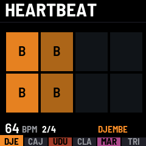
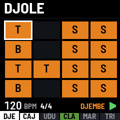
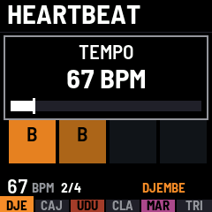
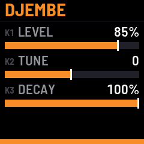
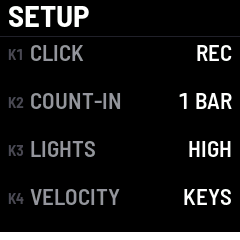
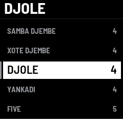
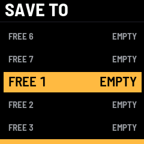
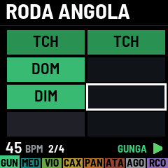
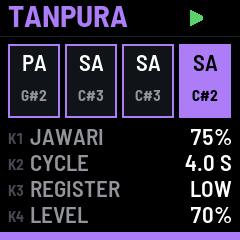
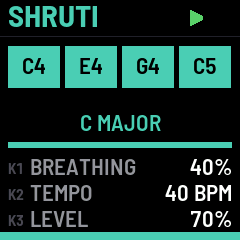

# DelRio

FM-1_DelRio turns the M-VAVE FM-1 into a small rhythm box of hand percussion, made to accompany songs in a circle:
djembe, cajon, udu, clapsticks, maracas and triangle. Choose a rhythm, set the tempo, press PLAY and sing; or play the
instruments on the keys, record them into the loop, and shape them step by step. The berimbau has its own page, with
its toques and the capoeira's bateria. Two drones, the tanpura and the shruti box, sound alone or under the rhythm.

---

## Contents

1. Install
2. The screen
3. Controls
4. Rhythms
5. Saving
6. The berimbau
7. The drones
8. USB
9. The screen reader
10. Troubleshooting

---

## 1. Install

**Try it first:** the [emulator](../emu/) runs the same code in the browser, with sound, played with the mouse, a touch
screen or the computer keyboard. It plays every key at the same strength, without pressure.

**Install from the browser:** in Chrome or Edge, connect the FM-1 by USB, open the [installer](../install/) and press
Install. The browser asks once to allow MIDI: allow it. Don't unplug the cable while it writes.

**Install from a terminal:** download the package from the [front page](../); then, in a clone of the
[source](https://github.com/jsopdebeeck/fm1-delrio) with its submodules,
`python3 base/tools/fm1_install.py delrio-VERSION.fwsc`. It needs mido with python-rtmidi.

**Back to the stock firmware:** the installer's "Back to the stock firmware" section writes M-VAVE's own firmware back.
What DelRio saved may be lost. An FM-1 that doesn't start can be recovered too: see Troubleshooting.

---

## 2. The screen

| Part | What it shows |
| --- | --- |
| Top | The rhythm's name; in the accent colour while it waits for its bar. A drone sounding under the rhythm: the rule under the name, in the drone's colour. |
| Panel | What a knob or a button changes, said large for a second (a rhythm's name, a second and a half): its title, its value, its bar where it has a range. It sits under the name, over the first steps; a key, PLAY, REC or a page's button takes it away at once. SELECT: SELECT INSTRUMENT over the instrument's name. PRESETS: PRESET over the rhythm's name, NEXT under it while it waits for its bar. |
| Steps | The instrument shown: a row a beat, its steps across. A stroke fills its step in the instrument's colour, dimmer when soft, with its name where it fits, else its letter. A small letter before it: a flam. The step sounding has a white frame. On a bar longer than the keys, a white mark at the left shows the rows on them. |
| Footer | The tempo, the bar's time signature and the instrument shown, in its colour. At the right: a green triangle playing, a red dot recording or counting in, a white square stopping on the bar. Counting in: the beats to go, large on red, top right. |
| Bottom row | The page's instruments in three letters, always in the same order: DJE CAJ UDU CLA MAR TRI, or GUN MED VIO CAX PAN ATA AGO RCO (the reco-reco). In their colour when they play in the rhythm, grey letters on the dark when not, white as they strike, grey when muted; the one shown taller. |
| Battery | Top right: three bars, the outline red when it is empty; USB while a computer powers the FM-1. For 5 s after the opening, 3 s after HOME or FX, and all the time with one bar left or none. A name that needs its place is shown large without it. |

The time signature is the bar's beats over 4; beats of three steps, their eighths over 8 (6/8, 12/8). The berimbau's
page shows its toques in 2/4.

At start, a maned wolf walks into the cerrado at dusk. A key, a button or a knob skips it, and does nothing else.

**The lights.** White keys: a stroke lit, each beat's first step brighter than the other empty ones, the step sounding
the other way round. Black keys: dim, the instrument shown's brighter, lit while held or as their instrument sounds.
PLAY is green playing, red recording, and blinks stopping on the bar. REC is lit recording and blinks counting in. SEQ
blinks the beat. SEL is lit on a muted instrument. SAVE is lit while there is something to save.

---

## 3. Controls

### The keys

The 16 white keys are a step sequencer for the instrument shown. Each press puts that step's next stroke, and after the
last, none; stopped, it sounds. A bar has 2 to 8 beats of 2, 3 or 4 steps. When it is longer than the keys, they follow
the step sounding, and stay there when it stops.

The 11 black keys play the instruments, harder is louder, grouped as the keys are:

| Black keys | Instrument and strokes |
| --- | --- |
| 1 to 3 | Djembe: bass (B), tone (T), slap (S). |
| 4, 5 | Cajon: bass (B), slap (S). |
| 6 to 8 | Udu: bass (B), tone (T), slap (S). Pressing the bass key harder lowers it (SOUND, BEND). |
| 9 | Clapsticks (X). |
| 10 | Maracas (X). |
| 11 | Triangle: held, it rings (O); let go, the hand closes on it. A short tap is a muted stroke (M). |

### The buttons

| Button | What it does |
| --- | --- |
| PLAY | Loops the rhythm. Playing: stops on the next bar's first beat, its strokes the last. Again: stops at once. |
| REC | Records what the black keys play, each stroke onto the nearest step, over what is there. From a stop, a bar is counted in first. Again: stops recording, and the loop goes on. |
| SEL | Mutes the instrument shown, or brings it back. |
| EDIT | Twice within 2 s: clears the instrument's steps. |
| SEQ | Taps the tempo: two taps or more, less than 1.5 s apart. Held while playing: the tempo rises (Rhythms). |
| ARP | Held: a djembe key plays a flam, and a white key makes the djembe's step a flam, or no longer one. On the berimbau's page: the agogô and the ladainha (The berimbau). |
| OCT− · OCT+ | The tempo, 5 BPM a press, 10 held. |
| LFO | Lists the presets, with their beats (a toque's, its counts), from the one chosen. KNOB 3 goes through them without changing anything. LFO held chooses the one shown; LFO again closes the list. |
| SAVE | Keeps the settings; a changed rhythm, in the FREE place you choose (Saving). |
| FX | The next page: the kit, the tanpura, the shruti box, the berimbau, and round. |
| HOME | The steps. |
| ENV | The instrument's SOUND page. |
| GLO | SETUP. |

"Held" is half a second.

### The knobs

| Knob | What it does |
| --- | --- |
| SELECT | The instrument shown. |
| ALGORITHM | The beats, 2 to 8: the first rhythm with that many. On the berimbau's page, the counts: 4 or 8. |
| PRESETS | Goes round the rhythms with those beats. |
| KNOB 1 to 4 | The page's settings, below. |
| MASTER | The volume. |

| Knob | HOME | SETUP (GLO) |
| --- | --- | --- |
| KNOB 1 | TEMPO: 40 to 240 BPM; on the berimbau's page, 20 to 120. | CLICK: OFF, REC (recording and counting in), ALWAYS. |
| KNOB 2 | STEPS: 2, 3 or 4 a beat. | COUNT-IN: OFF, 1 BAR. |
| KNOB 3 | SWING: 0 to 100 %, with 2 or 4 steps a beat. | LIGHTS: the keys', LOW or HIGH. |
| KNOB 4 | HUMAN: 0 to 100 %, the strokes up to 12 ms late and 30 % softer. | VELOCITY: KEYS, or FIXED (every stroke at 100). |

Each instrument's SOUND page (ENV) has only what a player of it can change:

| Instrument | KNOB 1 | KNOB 2 | KNOB 3 | KNOB 4 |
| --- | --- | --- | --- | --- |
| Djembe | LEVEL | TUNE | DECAY | |
| Cajon | LEVEL | SNARES | DECAY | |
| Udu | LEVEL | TUNE | BEND | |
| Maracas | LEVEL | DECAY | TYPE | |
| Triangle | LEVEL | DECAY | | |
| Gunga, medio, viola | LEVEL | TUNE | CABACA | VIRADAS |
| Atabaque | LEVEL | TUNE | | |
| Clapsticks, caxixi, agogô, pandeiro, reco-reco | LEVEL | | | |

- LEVEL: 0 to 100 %.
- TUNE: 3 semitones either way, by half steps.
- DECAY: 10 to 100 %: a hand on the djembe's head, a heel on the cajon's front, a short or long shake of the maracas,
  the triangle's ring.
- SNARES: the cajon's wires, off to 100 %.
- BEND: how far the udu's bass key pressed all the way lowers it, off to 6 semitones.
- TYPE: the maracas' SHAKER, CLASSIC, GOURD or DAIME.
- CABACA, VIRADAS: see The berimbau.

---

## 4. Rhythms

| Beats | Rhythms, on the kit |
| --- | --- |
| 2 | HEARTBEAT, BAIAO, XOTE, SAMBA, MARCHA 2/4, DAIME MAZURCA, BARRAVENTO, JOROPO |
| 3 | THREE, DAIME VALSA, TOADA |
| 4 | FOUR, JOURNEY, SHAKER, CLAVE, AFRO 12/8, DAIME MARCHA, IJEXA, IJEXA CANTO, KUKU, AFRO SAMBA, BOSSA NOVA, FUNK IJEXA, SAMBA DJEMBE, XOTE DJEMBE, DJOLE, YANKADI |
| 5 | FIVE |
| 6 | LANDO, BULERIAS |
| 7 | SEVEN |
| 8 | AFOXE |

| Counts | Toques, on the berimbau's page |
| --- | --- |
| 4 | ANGOLA, SB PEQUENO, SB GRANDE, BANGUELA, JOGO DE DENTRO, JOGO DE FORA, RODA ANGOLA |
| 8 | SB REGIONAL, CAVALARIA, IDALINA, MIUDINHO |

Where they come from: [the README](https://github.com/jsopdebeeck/fm1-delrio#the-rhythms).

- **Choosing.** ALGORITHM chooses the beats; PRESETS goes round the rhythms with those beats, then your own. A FREE
  place shows only when it holds a rhythm.
- **As it is written.** A written rhythm comes as it is written, at its tempo as last set. What you change in it lasts
  until you choose another; to keep it, SAVE it in a FREE place.
- **On the bar.** A rhythm chosen while one plays comes in on the next bar's first beat. A tempo set while playing
  glides there over a bar; a tapped one is there at once.
- **Its tempo.** Each rhythm keeps its tempo: set it once, and it comes back at it, away and back.
- **The tempo rising.** SEQ held while playing: a BPM every 12 beats (BPM in the accent colour, SEQ lit). OCT− or OCT+,
  or SEQ held again, keep the tempo reached; KNOB 1 or tapping end the rise at the tempo they set. Stopped, or another
  rhythm come in, the rhythm is back at its own.
- **Your own.** Choose a rhythm with the beats you want, change it or clear it (EDIT twice, an instrument at a time),
  play it or record it, then SAVE it in a FREE place.

---

## 5. Saving

Press SAVE to keep the settings: each rhythm's tempo, the sounds, SETUP and the drones. They come back the next time
the FM-1 starts. SAVE stays lit while there is something to save.

If the rhythm shown has changed, SAVE then opens SAVE TO: the FREE places, 7 for the kit and 2 for the berimbau, each
for a rhythm of any beats, EMPTY or with its time signature. KNOB 3 goes through them; SAVE puts the rhythm there, over
what it holds, and it plays on from there. HOME, ENV or GLO leaves the list, the rhythm not saved. A tempo or a mute is
no change to a rhythm. The written rhythms stay as they are.

DelRio keeps only its own settings and rhythms, in its own place in the FM-1's flash. It does not read other firmwares'
projects or samples.

---

## 6. The berimbau

FX brings its page, played as the kit is: the white keys its steps, PLAY, REC, the pages. SELECT shows the three
berimbaus of a roda, the GUNGA (the lowest), the MEDIO and the VIOLA, a tone up each; then the CAXIXI, the PANDEIRO, the
ATABAQUE, the AGOGO and the RECO-RECO, each with its steps. The kit and this page share one sequencer: going from one
to the other stops it.

| Black keys | Strokes |
| --- | --- |
| 1 to 3 | The berimbau shown (the gunga if none is): DOM (the wire struck free), DIM (the stone pressed on it, a tone higher), TSCH (the stone resting on it, a buzz; TCH on the screen). |
| 4, 5 | The caxixi, the reco-reco. |
| 6 to 8 | The pandeiro: TUM (thumb), PA (slap), CHIA (its jingles). |
| 9, 10 | The atabaque: TUM, PA. With ARP held: the agogô's high and low bells. |
| 11 | VIRADA: the berimbau shown varies from the next bar. With ARP held: the ladainha. |

- **The cabaça.** A berimbau's keys pressed harder close its gourd on the belly, its sound muffled as far as the
  pressure goes. SOUND, CABACA: how far, off to 100 %.
- **Viradas.** Each berimbau varies its toque now and then. SOUND, VIRADAS: OFF, EVERY 8, EVERY 4, EVERY 2 or EVERY BAR;
  the viola every 4 at first.
- **The ladainha.** ARP + VIRADA begins RODA ANGOLA as a roda of capoeira Angola begins, from a stop too: the gunga and
  its caxixi, then the medio, the viola and the pandeiro, two bars each, for the singer. Again: the chula, the atabaque,
  the agogô and the reco-reco on the next bar. Again: back to the base. PLAY stops as ever.
- **A toque's tempo.** This page shows the toques as their sources count them, in 2/4, the tempo its quarter note:
  ANGOLA at 45 BPM, its grid a row a count, four to the bar (eight, over two bars). OCT− and OCT+, KNOB 1, tapping and
  the tempo rising go by the number on the screen.

---

## 7. The drones

FX brings them right after the kit, which plays on under their pages. Both are synthesised as they play. One drone at a
time. On a drone's page, GLO opens SETUP and LFO lists its presets.

**PLAY on a drone's page** stops the drone if it sounds; else it stops the rhythm if one plays (on the next bar's first
beat; again: at once); else it starts the drone.

**A drone under the rhythm:** start the drone first. Its PLAY, then HOME (on its page) goes back to the kit, the drone
sounding on, and the kit's PLAY starts the rhythm. The berimbau's page stops the kit, not the drone.

The tanpura has four strings plucked in turn (Pa, Sa, Sa, low Sa), buzzing on their bridge (the jawari). The shruti box
holds its reeds while the bellows breathe; a bar under the reeds shows them breathing.

| Control | Tanpura | Shruti box |
| --- | --- | --- |
| A key | Sets Sa. | NOTES: opens or closes its reed. A chord: the chord on it. |
| ALGORITHM | The first string: SA PA, SA MA (the ragas without Pa), SA NI. | |
| PRESETS | Its character, the jawari and the cycle together: MEDITATION (slow, soft), MANTRA (round), RAGA (the concert tanpura's open jawari), KIRTAN (quicker, brighter). | NOTES, or the chord a key plays: SA PA (root, fifth, octave), MAJOR, MINOR. |
| KNOB 1 | JAWARI: 0 to 100 %. | BREATHING: how strongly the bellows breathe. STEADY at 0; at the most, the sound falls away where the hand turns. |
| KNOB 2 | CYCLE: 2 to 8 s. | TEMPO: a push, then a pull, each a beat, 20 to 120 BPM. Under 20, the rhythm's tempo, halved above 120 ("= 66 BPM"). |
| KNOB 3 | REGISTER: LOW, HIGH. | LEVEL: 0 to 100 %. |
| KNOB 4 | LEVEL: 0 to 100 %. | |
| EDIT | | Twice within 2 s: closes every reed. |

---

## 8. USB

Over the USB cable the FM-1 is also a sound card: a computer can record what it plays, from an input named "FM-1
DelRio". It is an input only: a computer can't play through it.

This firmware has no Bluetooth, and its keys send no MIDI.

---

## 9. The screen reader

DelRio tells a screen reader what's on its screen, through the
[FM-1 Screen Reader](https://charlesvestal.github.io/fm1-reader/): the instrument, the rhythm, its beats and its tempo
when the reader starts listening (on a drone's page, the drone's settings), then each change as it happens. The emulator
does the same, with your computer's own screen reader.

---

## 10. Troubleshooting

**No sound:** turn MASTER up. SEL lit: the instrument is muted. Its LEVEL may be down (ENV). A drone starts with PLAY,
on its page.

**PLAY doesn't stop at once:** it stops on the next bar's first beat. Press it again to stop now.

**A rhythm has lost its changes:** a written rhythm comes back as written when you choose it again. SAVE it in a FREE
place first.

**A FREE place isn't there:** PRESETS and LFO show only the places that hold a rhythm. SAVE's list shows them all.

**The installer doesn't find the FM-1:** use Chrome or Edge, allow MIDI when asked, and close other programs that use
the FM-1's MIDI port.

**The FM-1 doesn't start after an install:** after two failed starts it comes up in SAFE MODE, without sound, USB on:
install again from the web installer, or press PLAY to try again. If that fails too, it waits in the chip's update
mode: put the stock firmware back, then install again. For details, see felucca-bsp's
[`tools/fm1_rescue.sh`](https://github.com/hugelton/felucca-bsp/tree/main/tools).
